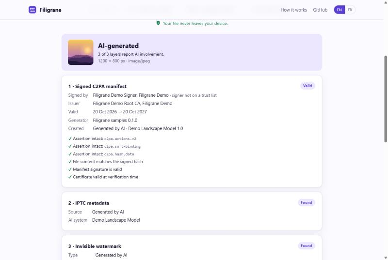

<div align="center">

# Filigrane

**La transparence de l'IA en open source pour l'AI Act européen : marquer, étiqueter et vérifier les contenus générés par IA.**

[Site et vérificateur en ligne](https://sailxe42.github.io/filigrane/) · [English](README.md)



</div>

Depuis le **2 août 2026**, l'article 50 de l'AI Act impose aux fournisseurs et déployeurs d'IA de signaler aux personnes qu'elles parlent à une IA, de marquer les contenus générés dans un format lisible par machine, et d'étiqueter les deepfakes. Les systèmes déjà sur le marché ont jusqu'au **2 décembre 2026** pour l'obligation de marquage. Les amendes vont jusqu'à 15 M€ ou 3 % du chiffre d'affaires mondial.

Filigrane transforme ces obligations en quelques lignes de TypeScript.

## Ce que fait Filigrane

- **Trois couches de marquage** : manifeste [C2PA](https://c2pa.org) signé (Content Credentials), métadonnées IPTC `DigitalSourceType` et filigrane invisible qui résiste à la recompression, au redimensionnement et à l'effacement des métadonnées. Le Code de bonnes pratiques de la Commission en attend au moins deux.
- **Vérification** : `verifyImage()` contrôle les trois couches, valide les signatures et détecte les falsifications. Le [vérificateur en ligne](https://sailxe42.github.io/filigrane/verify.html) tourne entièrement dans le navigateur.
- **Composants d'avertissement** : `<ai-disclosure>` (chatbots, art. 50(1)) et `<ai-label>` (images et textes d'IA, art. 50(4)), accessibles, dans les 24 langues officielles de l'UE, compatibles avec tous les frameworks.
- **Marquage du texte** : `markText()` ajoute des marqueurs invisibles par paragraphe qui survivent au copier-coller.
- **Analyse de projet** : `filigrane scan` repère les chatbots et générateurs sans mesure de transparence (JS/TS et Python) et produit un rapport texte, JSON, Markdown ou SARIF.
- **GitHub Action** : l'analyse sur chaque pull request, avec les résultats dans l'onglet sécurité.
- **Partout** : TypeScript pur sur WebCrypto, sans binaire natif. Node.js 20+, navigateurs, Deno, Bun, Cloudflare Workers, Vercel Edge.

## Démarrage rapide

```bash
npm install @filigrane/core @filigrane/ui
```

```ts
import { createLocalSigner, markImage } from '@filigrane/core';

const signer = await createLocalSigner({ certificate: process.env.FILIGRANE_CERT, privateKey: process.env.FILIGRANE_KEY });
const { bytes, layers } = await markImage(image, { signer, model: { name: 'gpt-image-1' } });
// layers → ['watermark', 'metadata', 'c2pa']
```

```html
<script type="module">import '@filigrane/ui';</script>
<ai-disclosure lang="fr" model="Assistant support" dismissible></ai-disclosure>
<ai-label kind="generated" variant="overlay"></ai-label>
```

```bash
npx filigrane scan . --format markdown   # rapport de transparence du projet
npx filigrane verify image.jpg           # vérifier un fichier
```

Le reste de la documentation (fonctionnement, robustesse mesurée, interopérabilité, feuille de route) est dans le [README en anglais](README.md). Un guide de l'article 50 pour les développeurs est disponible en [français](docs/article-50.fr.md).

## Mentions légales

Filigrane met en œuvre les mesures techniques décrites dans le Code de bonnes pratiques de la Commission européenne. **Ce n'est pas un avis juridique et cela ne garantit pas à lui seul la conformité** : les obligations dépendent de votre rôle (fournisseur ou déployeur), de votre produit et de la façon dont les contenus sont publiés. Projet indépendant, sans lien avec la Commission européenne, la C2PA ou l'IPTC.

## Licence

[MIT](LICENSE) © 2026 Alexis Nieto
