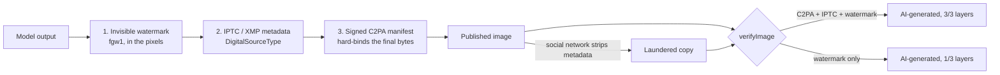

<div align="center">

# Filigrane

**Open-source AI transparency for the EU AI Act — mark, label and verify AI-generated content.**

[](https://github.com/Sailxe42/filigrane/actions/workflows/ci.yml)
[](#interoperability-and-tests)
[](LICENSE)
[](#packages)

[Website & online verifier](https://sailxe42.github.io/filigrane/) · [Quick start](#quick-start) · [How it works](#how-it-works) · [Français](README.fr.md)


</div>

Since **2 August 2026**, Article 50 of the EU AI Act requires AI providers and deployers to tell people when they talk to an AI, to mark AI-generated content in a machine-readable way, and to label deepfakes. Systems already on the market have until **2 December 2026** for the marking obligation. Fines go up to €15 million or 3 % of worldwide turnover.

Filigrane turns those obligations into a few lines of TypeScript:

```ts
import { markImage } from '@filigranejs/core';

const { bytes } = await markImage(png, { signer, model: { name: 'gpt-image-1' } });
// → invisible watermark + IPTC "AI-generated" metadata + signed C2PA manifest
```

```html
<ai-disclosure model="Mistral Large" dismissible></ai-disclosure> <!-- 24 EU languages -->
```

## Features

| | |
| --- | --- |
| **Three marking layers** | Signed [C2PA](https://c2pa.org) manifest (Content Credentials), IPTC `DigitalSourceType` metadata, and an invisible watermark that survives recompression, resizing and metadata stripping. The Commission's Code of Practice expects at least two. JPEG, PNG and WebP. |
| **Verification** | `verifyImage()` checks all three layers, validates signatures and flags tampering. The [online verifier](https://sailxe42.github.io/filigrane/verify.html) runs entirely in the browser. |
| **Disclosure components** | `<ai-disclosure>` (chatbots, Art. 50(1)) and `<ai-label>` (AI images and texts, Art. 50(4)) with the official EU icons: accessible Web Components in the 24 official EU languages, for any framework. |
| **Text marking** | `markText()` adds invisible, paragraph-level markers that survive copy/paste. |
| **Project scanner** | `filigrane scan` finds chatbots and generators without transparency measures (JS/TS and Python) and reports them as text, JSON, Markdown or SARIF. |
| **GitHub Action** | Runs the scanner on every pull request and surfaces findings in code scanning. |
| **Runs everywhere** | Pure TypeScript on WebCrypto: Node.js 20+, browsers, Deno, Bun, Cloudflare Workers, Vercel Edge. No native binaries. |

## Quick start

### 1. Mark AI-generated images (server)

```bash
npm install @filigranejs/core
```

```ts
import { createLocalSigner, markImage } from '@filigranejs/core';

const signer = await createLocalSigner({
  certificate: process.env.FILIGRANE_CERT, // PEM chain: signing certificate first
  privateKey: process.env.FILIGRANE_KEY,   // PEM private key (ECDSA P-256/384/521)
});

const result = await markImage(imageBytes, {
  signer,
  model: { name: 'gpt-image-1' },
  generator: { name: 'My App', version: '1.0.0' },
  involvement: 'generated', // or 'modified' for real content altered by AI
});
// result.layers → ['watermark', 'metadata', 'c2pa']
```

No certificate yet? `createDevSigner()` (or `npx filigrane keygen`) creates a throw-away chain for development. See [Signing certificates](docs/certificates.md).

**WebP**: the metadata and C2PA layers work out of the box. To watermark WebP pixels, register a codec — `createSharpCodec(sharp)` in Node.js or `createCanvasCodec()` in browsers:

```ts
import sharp from 'sharp';
import { createSharpCodec, registerImageCodec } from '@filigranejs/core';
registerImageCodec('webp', createSharpCodec(sharp));
```

### 2. Tell users they are talking to an AI

```bash
npm install @filigranejs/ui
```

```ts
import '@filigranejs/ui'; // registers <ai-disclosure> and <ai-label>
```

```html
<ai-disclosure model="Support assistant" href="/ai-policy" dismissible remember="chat"></ai-disclosure>

<figure style="position: relative">
  
  <ai-label variant="overlay" model="Flux 1.1"></ai-label>
</figure>
```

The components follow the page language (`lang` attribute), can be themed with `--fg-ai-*` CSS variables and keep a visible "AI" chip after the banner is dismissed. Labels use the [official EU icons](https://digital-strategy.ec.europa.eu/en/policies/eu-icons-labelling-ai-generated-content) (free to use; `variant="eu"` shows the full "AI GENERATED" / "AI MODIFIED" label, `icon="filigrane"` switches to Filigrane's icon). Using the icons does not by itself signal adherence to the Code of Practice. React typings: [examples/nextjs/global.d.ts](examples/nextjs/global.d.ts).

### 3. Verify any file

```ts
import { verifyImage } from '@filigranejs/core';

const report = await verifyImage(bytes);
report.verdict;          // 'ai-generated' | 'ai-modified' | 'no-ai-signal'
report.c2pa.active?.valid;
report.watermark.detected;
report.tampered;         // file changed after signing
```

### 4. Scan your project in CI

```bash
npx filigrane scan . --format markdown
```

```yaml
# .github/workflows/ai-transparency.yml
on: [pull_request]
permissions: { contents: read, security-events: write }
jobs:
  scan:
    runs-on: ubuntu-latest
    steps:
      - uses: actions/checkout@v5
      - uses: Sailxe42/filigrane@v0
```

## Using an AI coding assistant?

Point it to [`llms.txt`](https://sailxe42.github.io/filigrane/llms.txt): a compact, accurate summary of the API written for AI assistants. Or paste this prompt:

```text
Make this app transparent for EU AI Act Article 50 using Filigrane (https://sailxe42.github.io/filigrane/llms.txt):
mark every generated image with markImage() from @filigranejs/core on the server, add <ai-disclosure> from
@filigranejs/ui to the chat UI, and add `npx filigrane scan . --format markdown` to CI.
```

## How it works



- **C2PA manifest** — a claim v2 with salted `c2pa.actions.v2` (`c2pa.created`, IPTC source type, model name), a `c2pa.soft-binding` assertion that references the watermark, and a `c2pa.hash.data` hard binding, signed with COSE_Sign1 (ES256/384/512). Implemented from the specification in TypeScript: CBOR, JUMBF, JPEG APP11 and PNG `caBX` embedding, X.509 parsing and generation.
- **IPTC metadata** — XMP `Iptc4xmpExt:DigitalSourceType` (`trainedAlgorithmicMedia` or `compositeWithTrainedAlgorithmicMedia`), the IPTC 2025 `AISystemUsed` field and a `dcterms:provenance` link to the manifest.
- **Watermark (fgw1)** — a 64-bit codeword (magic, flags, 32-bit id, CRC-16) spread over mid-low frequency DCT coefficients of a 256-pixel canonical luminance image, with texture-adaptive, informed embedding. See [docs/watermark.md](docs/watermark.md).

### Watermark robustness

Measured by [`scripts/benchmark-watermark.mjs`](scripts/benchmark-watermark.mjs) on five photo-like images (1024×768 to 3000×2000). Average invisibility: **43.8 dB PSNR**.

| Transformation | Detected |
| --- | --- |
| JPEG quality 90 / 75 / 50 / 30 | 5/5 each |
| Resize to 50 %, upscale to 150 % | 5/5 each |
| Resize to 25 % + JPEG 80 | 5/5 |
| Brightness +20, contrast ×1.2 | 5/5 each |
| Metadata stripped + JPEG 75 (social network) | 5/5 |
| False positives on unmarked images | 0/20 |

Not supported yet: cropping, rotation, mirroring. Run `npm run build && node scripts/benchmark-watermark.mjs` to reproduce.

## Packages

| Package | Description |
| --- | --- |
| [`@filigranejs/core`](packages/core) | Marking, verification, C2PA, watermark, IPTC, text markers |
| [`@filigranejs/ui`](packages/ui) | `<ai-disclosure>` and `<ai-label>` Web Components, 24 languages |
| [`filigrane`](packages/cli) | CLI: `mark`, `verify`, `scan`, `keygen` |
| [`apps/site`](apps/site) | Website, online verifier and playground |

## Interoperability and tests

- **Interoperability with the reference implementation**: on every commit, CI marks JPEG, PNG and WebP files and validates them with the C2PA reference implementation ([c2pa-rs](https://github.com/contentauth/c2pa-rs), through `c2pa-python`). All of them are reported **Valid**. Filigrane also validates manifests produced by c2pa-rs ([fixture](packages/core/test/fixtures)). This is an interoperability test, not a certification: Filigrane is not on the C2PA Conforming Products List.
- **85 automated tests**: RFC 8949 CBOR vectors, X.509/COSE, tamper detection, watermark robustness and false positives, components in 24 languages, scanner rules and SARIF output.
- **CI** on Node.js 20, 22 and 24.

```bash
npm install
npm test               # unit and integration tests
npm run build
npm run interop        # needs: pip install c2pa-python
```

## Roadmap

- [ ] Timestamping (RFC 3161) for long-lived signatures
- [x] WebP (pixels via a registered codec)
- [ ] AVIF and HEIC; audio (MP3, WAV) and video (MP4) marking
- [ ] Crop-resistant watermark (v2)
- [x] Official EU icons bundled in `<ai-label>`
- [ ] C2PA text manifests for unstructured text
- [ ] Hosted verification API

## Legal

Filigrane implements technical measures described in the European Commission's Code of Practice on marking and labelling of AI-generated content. **It is not legal advice and does not by itself guarantee compliance**: obligations depend on your role (provider or deployer), your product and how content is published. Filigrane is an independent project, not affiliated with the European Commission, the C2PA or the IPTC.

## Built with AI assistance

This project is developed with the help of an AI coding assistant (Claude). The maintainer sets the direction and reviews the changes; every technical claim in this README is backed by an automated test or a reproducible script.

## Contributing

Contributions are welcome — especially translation reviews by native speakers, new framework examples and scanner rules. See [CONTRIBUTING.md](CONTRIBUTING.md). Security issues: [SECURITY.md](SECURITY.md).

## License

[MIT](LICENSE) © 2026 Alexis Nieto
